# Vision Only Leader Follower Warehouse Coordination

[](https://github.com/justneeraj12/ee616-vision-leader-follower/actions/workflows/ci.yml)
[](work/toy_simulation/pyproject.toml)
[](docs/PROJECT_STATUS.md)
[](docs/PROJECT_STATUS.md)
[](docs/PROJECT_STATUS.md)
[](https://www.clarkson.edu/)

A reproducible research project for camera-only predecessor following in a flexible warehouse material-delivery convoy.

The leader owns the route. Each independently driven follower observes the robot immediately ahead through a forward RGB camera, combines the relative visual measurement with local wheel odometry, and uses bounded control to maintain a commanded gap. The planned implementation targets ROS 2 Jazzy and Gazebo Harmonic on constrained laptop hardware.

> **Current status:** deterministic toy baseline, containerized ROS 2/Gazebo foundation, synchronized YOLOv8n v3 measurement gate complete, nominal incremental chains through three followers passed, controlled-disturbance and timing gates passed, and a mapped pair-first warehouse mission using Nav2 Hybrid-A* passed.
>
> The first two YOLOv8n checkpoints remain recorded failures. After correcting an RGB/BGR runtime mismatch and stale-frame labels, v3 passed on two new sealed scenes, six nominal closed-loop pair runs, 12 staged nominal chain runs, and 18 pair-first controlled-disturbance runs. Physical robots and production safety have not been demonstrated.

## Start here

This repository contains the simulation implementation, automated tests,
machine-readable experiment results, and recorded demonstrations. A practical
navigation path is:

1. [System architecture](docs/SYSTEM_ARCHITECTURE.md) - robot roles, data flow,
   namespaces, and the ground-truth boundary.
2. [Environment setup](docs/ENVIRONMENT_SETUP.md) - container, ROS 2, Gazebo,
   and GPU setup.
3. [Gazebo demonstration guide](docs/GAZEBO_DEMO_GUIDE.md) - live commands,
   recorded results, and interpretation limits.
4. [Final evidence index](docs/FINAL_EVIDENCE_INDEX.md) - gate-by-gate
   machine-readable evidence and reproduction commands.
5. [Deliverables index](deliverables/README.md) - videos, screenshots, checksums,
   and baseline archives.

The fastest visual review is the
[mapped Hybrid-A* warehouse mission](deliverables/Neeraj_Kanchani_EE616_Hybrid_AStar_Warehouse_Demo.mp4),
[scripted-route warehouse cargo mission](deliverables/Neeraj_Kanchani_EE616_Warehouse_Mission_Demo.mp4),
[pair-turn demonstration](deliverables/Neeraj_Kanchani_EE616_Gazebo_Pair_Turn_Demo.mp4),
the [three-follower chain](deliverables/Neeraj_Kanchani_EE616_Gazebo_Three_Follower_Chain_Demo.mp4),
and the [visual-loss recovery demonstration](deliverables/Neeraj_Kanchani_EE616_Gazebo_Recovery_Demo.mp4).
These are presentation runs. The frozen Gate 1--7 directories remain the primary
scientific evidence.

### Presentation screenshots

| Receiving loading | Hybrid-A* aisle turn | Dispatch settle |
|---|---|---|
| 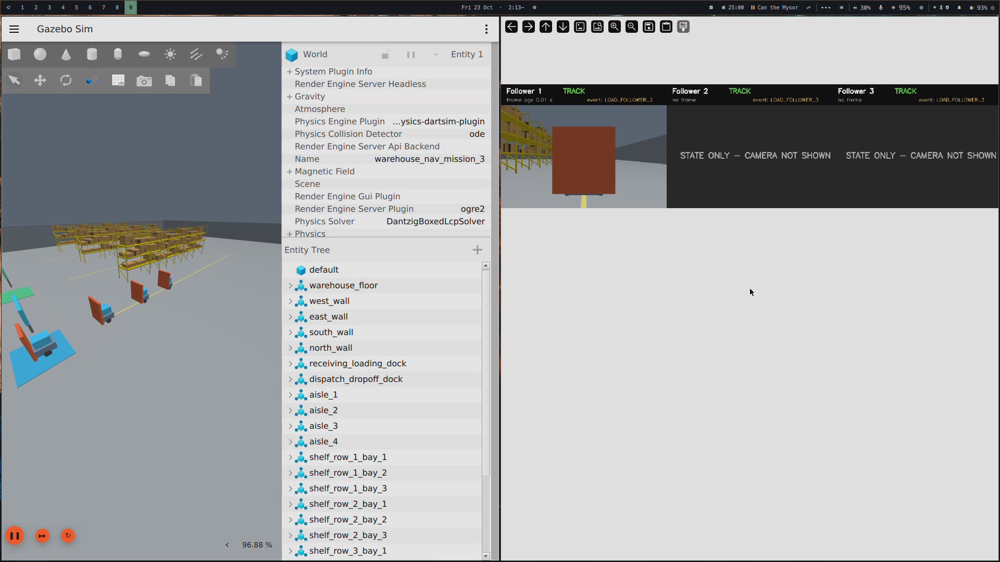 | 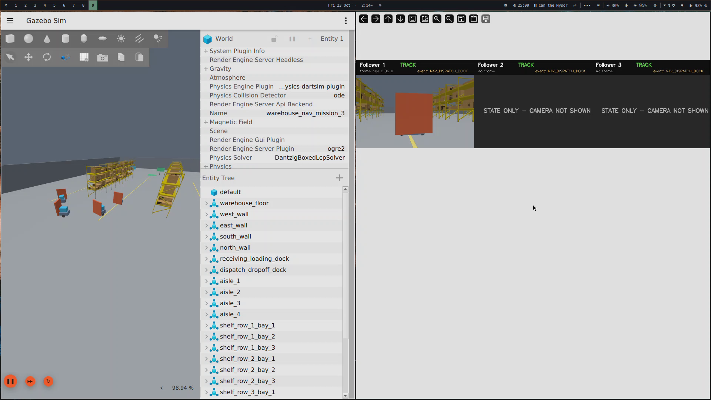 | 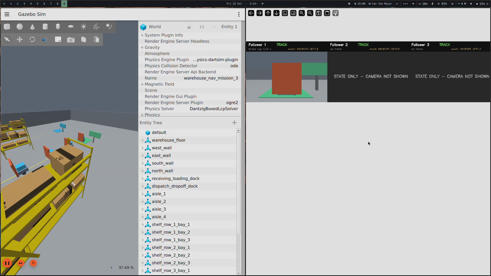 |

| Warehouse loading sequence | Loaded convoy | Drop-off settle |
|---|---|---|
| 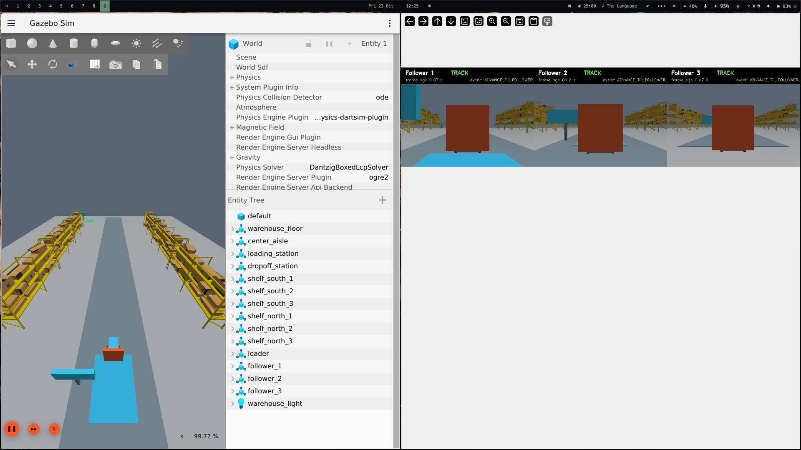 | 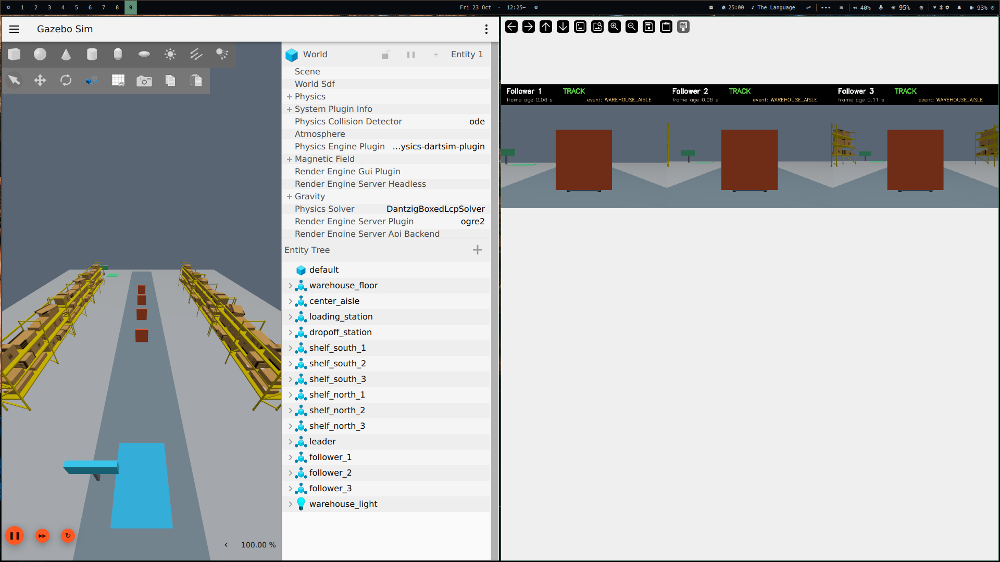 | 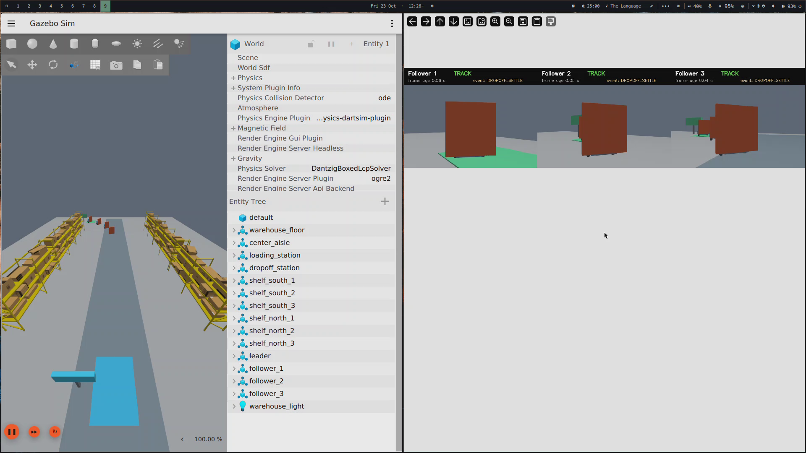 |

| Pair gradual turn | Three-follower chain |
|---|---|
|  | 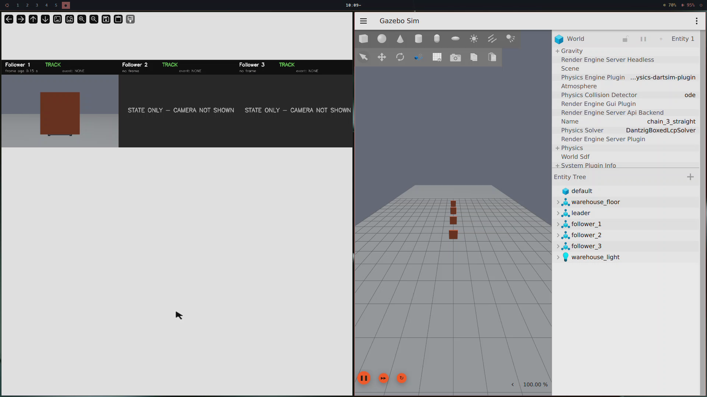 |

| Visual loss: PREDICT | Visual loss: SAFE STOP | Target reacquired |
|---|---|---|
| 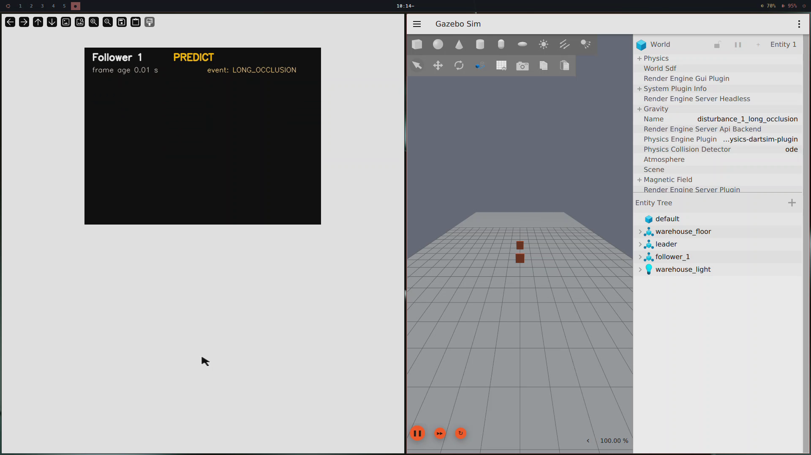 | 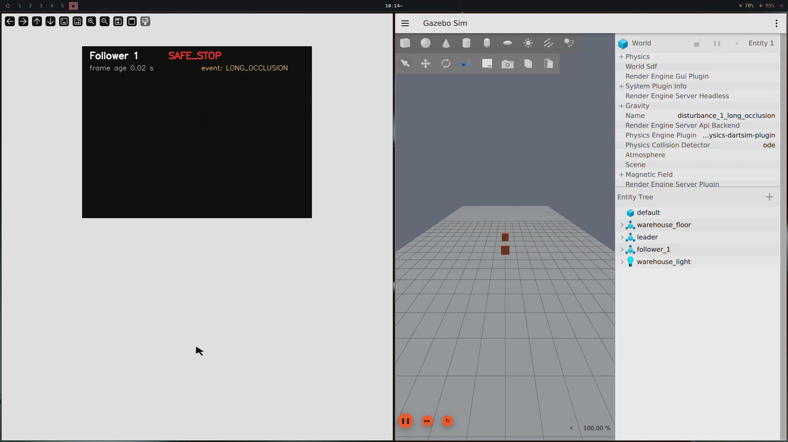 | 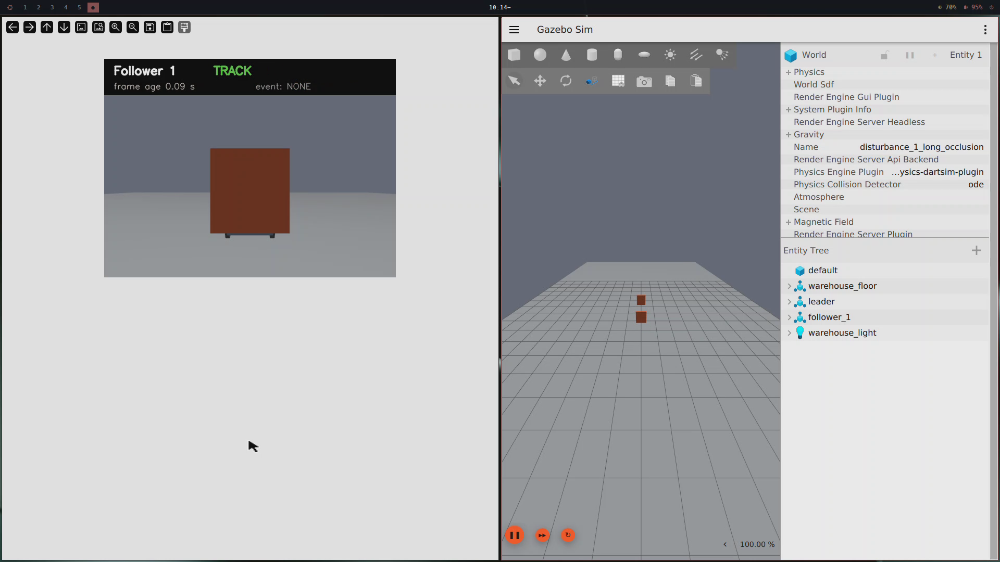 |

The images are extracted video frames, not additional experiment repetitions.
See the [screenshot index](deliverables/screenshots/README.md) for provenance.

## Research objective

The primary research question is:

> How accurately and reliably can a resource-constrained follower robot maintain leader-relative formation using a forward RGB camera and local odometry under changes in range, heading, velocity, turns, and short visual occlusions?

The minimum scientific unit is one leader and one follower. Additional followers will be introduced one at a time only after the pair is validated. This ordering makes perception error, estimator behavior, closed-loop control, and rearward error propagation independently measurable.

## Why this project

Warehouse and manufacturing operations repeatedly move parts, picked goods, containers, and work-in-process inventory along common routes. The proposed convoy studies whether independently driven carts can reproduce a predecessor's motion without mechanically coupling every load or assigning full route planning to every follower.

The project combines:

- monocular camera geometry and target detection;
- relative-state estimation through short measurement gaps;
- bounded range-and-bearing control;
- explicit `TRACK`, `PREDICT`, and `SAFE STOP` behavior;
- isolated ROS 2 namespaces for repeated follower instances;
- synchronized experiment logging and evaluation-only ground truth;
- incremental multi-follower validation;
- timing and resource measurements on constrained hardware.

## Verified evidence

### Current ROS 2 and Gazebo results

These are the primary project results. RMSE and MAE are errors, so lower values
are better. The values below come from the frozen repeated experiments, not from
a selected live demonstration.

| Experiment | Main result | What it shows |
|---|---|---|
| Camera-geometry baseline | 0.0355 m (3.55 cm) range RMSE; 0.120° bearing MAE | The monocular range-and-bearing calculation works with a fixed red target in Gazebo. |
| YOLOv8n v3 measurement | 100% valid; 0.0323 m (3.23 cm) range RMSE; 0.1569° bearing MAE; 9.02 ms inference p95 | The final detector passed two sealed static scenes before entering control. |
| One leader and one follower | Worst spacing RMSE: 0.0558 m (5.58 cm) straight and 0.1005 m (10.05 cm) during turns | All six nominal pair runs passed with zero evaluator collision samples. |
| Incremental three-follower chain | Worst spacing RMSE: F1 0.1004 m, F2 0.0739 m, F3 0.0523 m | All 12 staged nominal runs passed. Rearward error growth was not observed under these nominal conditions. |
| Scripted-route warehouse cargo mission | Three-run mean transport RMSE: F1 0.0734 m, F2 0.0642 m, F3 0.0492 m; zero collision samples | The pair passed before three full pickup, gradual-turn transport, and drop-off repetitions. |
| Mapped Nav2 warehouse mission | Three-run mean transport RMSE: F1 0.1313 m, F2 0.1392 m, F3 0.1331 m; zero robot or mapped-obstacle collision samples | The leader used AMCL, a static map, LiDAR, Hybrid-A*, and Regulated Pure Pursuit through three aisle turns. Each follower remained camera-and-odometry only. |
| Controlled disturbances | Pair worst RMSE: 0.1247 m; combined-chain worst RMSE: F1 0.1007 m, F2 0.1242 m, F3 0.1403 m | All 18 pair-first runs passed. The combined disturbance showed error growth toward the rear. |
| Target-laptop timing | 23.09 ms camera-to-measurement p95; 48.35 ms measurement-to-control p95; minimum real-time factor 0.9996 | Three combined-chain runs met the frozen timing limits on the target laptop. |
| Resource use | 3,584 MiB peak container RAM; 642 MiB peak visible VRAM | The accepted timing experiment stayed within the laptop's 16 GB RAM and 4 GB VRAM limits. |
| ROS verification | 5 packages built; 85 tests passed | The repository tests cover simulation, perception, estimation, control, and evaluation components. |

The evaluator recorded zero collision samples in these defined Gazebo gates.
This is simulation evidence and is not proof of physical-robot or person safety.

### Retained detector-development results

Failed experiments are retained because they explain why only the v3 detector
was allowed into follower control.

| Detector | Result | Decision |
|---|---|---|
| Initial YOLOv8n | 79.6% valid; 0.505 m range RMSE | Failed the valid-rate and range limits; blocked from control. |
| Corrective YOLOv8n | 0% valid on the independent final scenes | Failed; range and bearing errors were undefined; blocked from control. |
| Synchronized YOLOv8n v3 | 100% valid; 0.0323 m range RMSE | Passed the sealed measurement gate and was used in the later Gazebo experiments. |

### Preliminary deterministic toy baseline

These early Python results demonstrate the proposed structure only. They are not
ROS 2, Gazebo-physics, or real-image evidence.

| Toy experiment | Result | Boundary |
|---|---|---|
| Single pair | 32 trials; 0.011 m median range RMSE; 0.104° median bearing MAE; 0.009 m median formation RMSE | Simplified camera geometry and kinematic robot motion. |
| Forced occlusion | 0.030 s median reacquisition time | The visual-loss interval was declared directly by the toy simulator. |
| Warehouse chain | 86 simulated seconds; seven route segments; F1--F3 spacing RMSE of 0.140, 0.164, and 0.200 m | One leader and three followers in a two-dimensional six-shelf toy map. |
| Toy collision check | Zero collision samples | Simplified center-and-radius check; not a safety result. |
| Toy tests | 7 passing | Determinism and basic implementation behavior only. |

Metric key:

- **RMSE:** error magnitude with extra weight on large errors; reported in the original unit.
- **MAE:** average absolute error; reported in the original unit.
- **p95:** 95% of recorded samples were at or below this value.
- **Valid rate:** percentage of fully visible evaluation samples that produced a usable measurement.
- **Real-time factor:** simulated time divided by wall-clock time; approximately 1.0 means real-time execution.

The machine-readable sources are under [`work/ros2_ws/results`](work/ros2_ws/results)
and [`work/toy_simulation`](work/toy_simulation). The
[`final evidence index`](docs/FINAL_EVIDENCE_INDEX.md) maps the frozen claims to
their exact CSV and JSON sources.

## System architecture

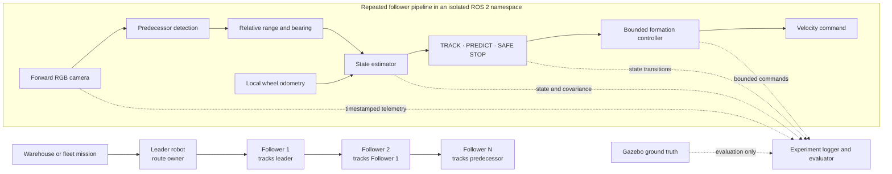

Gazebo ground truth may be logged for evaluation, but it must never enter detection, estimation, supervision, or control. Each robot will use the same follower interfaces under a separate namespace.

## Camera measurement model

The toy baseline uses a pinhole-camera relationship with a known target height:

- range estimate: `r = f × H / h`
- bearing estimate: `θ = atan((cx - u) / f)` for positive-left bearing

Here `f` is focal length in pixels, `H` is known target height, `h` is detected bounding-box height, `u` is the horizontal box center, and `cx` is the camera principal point. The fixed detector and synchronized YOLOv8n v3 detector passed static Gazebo measurement gates. Nominal closed-loop pair and incremental-chain behavior passed their defined matrices. The pipeline also passed the frozen controlled-disturbance matrix described below.

## Supervisory behavior

| State | Entry condition | Allowed behavior |
|---|---|---|
| `TRACK` | A recent valid measurement is available | Update the estimate and apply bounded control |
| `PREDICT` | Detection is temporarily unavailable | Predict for no longer than the configured timeout |
| `SAFE STOP` | The estimate is unavailable or stale | Command zero linear and angular velocity |

These states define deterministic research behavior. They do not establish certified braking distance or person safety.

## Preliminary warehouse demonstration

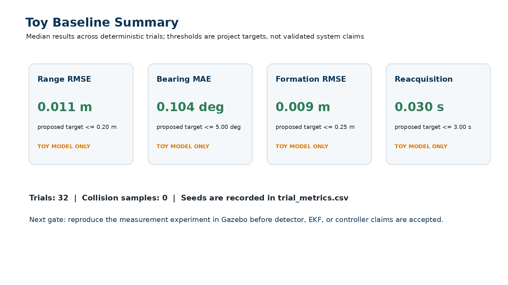

[Download the multi-follower warehouse demonstration video](deliverables/Neeraj_Kanchani_EE616_Multi_Follower_Warehouse_2D.mp4)

The video shows one leader and three independently controlled followers moving through a six-shelf maze. It is a two-dimensional kinematic demonstration intended to explain topology, logging, and presentation. It is not a Gazebo or physical-robot result.

## Validation roadmap

| Gate | Scope | Status |
|---:|---|---|
| 1 | ROS 2 Jazzy and Gazebo Harmonic environment and reproducibility validation | Complete |
| 2 | Camera-only range and bearing measurements against evaluation ground truth | Complete; fixed baseline and synchronized YOLOv8n v3 passed |
| 3 | One leader and one follower with estimator, bounded controller, and recovery states | Complete for nominal straight and gradual-turn runs |
| 4 | Followers added incrementally with error-propagation measurements | Complete for nominal straight and gradual-turn runs |
| 5 | Turns, occlusions, stopped leaders, and controlled disturbances | Complete for the frozen simulated pair-first matrix |
| 6 | Resource and inference benchmarks on the target laptop | Complete |
| 7 | Frozen experiments, final video, report, and submission package | Complete |

The validated pair remains the minimum scientific result. The one-leader/three-follower target also passed three combined controlled-disturbance runs after all 15 pair runs passed.

## Containerized ROS 2 and Gazebo foundation

The approved ROS 2 implementation is organized under `work/ros2_ws/`. An official ROS 2 Jazzy Ubuntu Noble image provides the canonical environment, with Gazebo Harmonic installed through the supported `ros_gz` packages.

```bash
make container-config
make container-build
make environment-check
```

The foundation passed on the target laptop with ROS 2 Jazzy, Gazebo Sim 8.15.0, two isolated namespaces, and timestamped camera transport. The optional NVIDIA profile sees the RTX 3050 Ti and 4 GB VRAM. The later fixed-red-target experiment adds camera-geometry evidence only; it is not follower-performance evidence.

See [the environment setup](docs/ENVIRONMENT_SETUP.md) and [system architecture](docs/SYSTEM_ARCHITECTURE.md) for host prerequisites, GPU configuration, robot roles, and evidence boundaries.

For interactive development, open the repository in VS Code and select **Dev Containers: Reopen in Container**. Then run the `EE616: Start simulation workspace` task to build the ROS workspace, open the Gazebo warehouse playground, and start a separate ROS learning shell. See the [developer workflow](docs/DEVELOPER_WORKFLOW.md), [project learning maps](docs/LEARNING_MAPS.md), and [metrics guide](docs/METRICS_GUIDE.md).

Choose a controlled Gazebo scene or run the optional imported-world benchmark:

```bash
make scenario-gui SCENARIO=straight_aisle
make scenario-validate
make aws-warehouse-gui
make aws-benchmark
```

See [the scenario matrix](docs/SCENARIO_MATRIX.md) for the controlled variables, AWS provenance, measured laptop load, and evidence boundaries.

### Live Gazebo demonstrations

The post-freeze demonstration launchers open Gazebo beside a read-only camera and
supervisor dashboard on Hyprland/XWayland. They write only to a separate
`demo_runs` result directory and do not alter the frozen Gate 1--7 evidence.
On the target laptop, Gazebo uses Intel Mesa graphics while YOLOv8n uses the
RTX 3050 Ti through a compute-only CUDA mapping.

Run the executable wrappers from any working directory:

```bash
./launchers/pair_turn.sh
./launchers/chain_straight.sh
./launchers/chain_turn.sh
./launchers/recovery.sh
./launchers/warehouse_mission.sh
./launchers/warehouse_nav_mission.sh
```

Each wrapper selects exactly one existing demonstration mode and delegates the
environment preparation, ROS workspace build, and Gazebo launch to the verified
project launcher.

```bash
make gazebo-demo DEMO_MODE=pair_turn
make gazebo-demo DEMO_MODE=chain_straight
make gazebo-demo DEMO_MODE=recovery
make gazebo-demo DEMO_MODE=warehouse_mission
make gazebo-demo DEMO_MODE=warehouse_nav_mission
```

Use `make gazebo-demo-record DEMO_MODE=<mode>` to record the selected mode. See the
[Gazebo demonstration guide](docs/GAZEBO_DEMO_GUIDE.md) for the exact workflow,
verified video results, and evidence limits.

The YOLOv8n stage uses separated dataset-only Gazebo scenes and an isolated camera-only backend. See [the YOLOv8n gate protocol](docs/YOLOV8N_GATE.md). The first two checkpoints remain recorded failures. The synchronized v3 checkpoint passed its sealed static measurement gate and the nominal one-pair integration gate.

Reproduce the six-run pair matrix with:

```bash
make pair-gate
```

This command requires the NVIDIA Docker profile and writes raw CSV rows, per-run summaries, the aggregate summary, resource measurements, and a traceable figure under `work/ros2_ws/results/pair_gate/`.

Reproduce the staged incremental-chain matrix with:

```bash
make chain-gate
```

The runner requires all six two-follower runs to pass before it launches the six three-follower runs. Evidence is written under `work/ros2_ws/results/chain_gate/`.

Reproduce the pair-first controlled-disturbance matrix with:

```bash
make disturbance-gate
```

The runner requires all 15 pair runs to pass before it launches three combined three-follower runs. It retains raw CSV rows, per-run JSON, resource measurements, a summary figure, and SHA-256 checksums under `work/ros2_ws/results/disturbance_gate/`.

Reproduce the target-laptop timing and resource matrix with:

```bash
make timing-gate
```

The runner repeats the accepted combined three-follower scenario three times. It retains observer timing rows, the corresponding behavior summaries, resource time series, an aggregate summary, a traceable figure, and SHA-256 checksums under `work/ros2_ws/results/timing_gate/`.

Reproduce the pair-first warehouse cargo mission with:

```bash
make warehouse-mission-gate
```

The runner requires a leader-follower pair mission to pass before it starts
three full leader-plus-three-follower repetitions. Results, resource samples,
checksums, and the traceable plot are under
[`work/ros2_ws/results/warehouse_mission`](work/ros2_ws/results/warehouse_mission).

Reproduce the mapped pair-first Nav2 mission with:

```bash
make warehouse-nav-mission-gate
```

The leader localizes with AMCL, plans with Nav2 Smac Hybrid-A*, and follows the
path with Regulated Pure Pursuit. The pair must pass before three full
leader-plus-three-follower repetitions run. Results, resources, checksums, and
the traceable plot are under
[`work/ros2_ws/results/warehouse_nav_evidence`](work/ros2_ws/results/warehouse_nav_evidence).

## Quickstart

Clone the repository and create a Python environment:

```bash
git clone https://github.com/justneeraj12/ee616-vision-leader-follower.git
cd ee616-vision-leader-follower/work/toy_simulation
python3 -m venv .venv
source .venv/bin/activate
python -m pip install --upgrade pip
python -m pip install -e .
```

Run the automated tests:

```bash
python -m unittest discover -s tests -v
```

Regenerate the single-pair baseline:

```bash
python -m toy_swarm.run --output results
```

Regenerate the warehouse experiment:

```bash
python run_warehouse.py
```

The commands write machine-readable summaries, time series, and figures beneath `work/toy_simulation/`. Passing the toy tests does not validate the later ROS 2 or Gazebo system.

## Repository layout

```text
.
├── .github/workflows/         Continuous integration
├── deliverables/              Videos, screenshots, checksums, and baseline archives
├── docs/                      Setup, architecture, protocols, and evidence indexes
├── launchers/                 One-command live Gazebo demonstration wrappers
├── references/                Original supplied project context
├── work/
│   ├── ros2_ws/               ROS 2 packages, scripts, and experiment results
│   └── toy_simulation/
│       ├── src/toy_swarm/     Simulator, measurement, filter, control, and plots
│       ├── tests/             Automated toy-baseline tests
│       ├── results/           Single-pair evidence
│       └── warehouse_results/ Multi-follower evidence
├── PROJECT_MASTER_PROMPT.md   Standing project and evidence rules
├── CONTRIBUTING.md            Contribution and approval workflow
├── CHANGELOG.md               Reviewable project milestones
└── CITATION.cff               Repository citation metadata
```

The `work/` placement is intentional. Project source, datasets, experiment
outputs, and internal checks remain separate from compact artifacts in
`deliverables/`.

## Reproducibility and research integrity

- Random seeds and experiment configurations are recorded.
- Tests reject non-finite outputs and check deterministic behavior.
- Measured results, proposed targets, and planned work are labeled separately.
- Ground truth is restricted to logging and evaluation in the planned simulator.
- Follower namespaces must remain isolated as the chain grows.
- Reported values must be traceable to committed JSON or CSV evidence.
- A failed or incomplete experiment will be reported rather than replaced with an unsupported claim.
- New implementation gates require approval before code, dependency, or architecture changes begin.

## Target hardware

Development targets an MSI Katana GF66 12UD with:

- Intel Core i5-12450H;
- 16 GB RAM;
- NVIDIA RTX 3050 Ti Laptop GPU with 4 GB VRAM;
- Ubuntu 26.04.1 LTS host with Docker; the canonical container remains Ubuntu Noble with ROS 2 Jazzy and Gazebo Harmonic.

The project will establish an ordinary FP32 inference baseline before considering FP16. INT8 will be considered only if calibration evidence shows acceptable accuracy loss. Gazebo rendering and inference share the same limited GPU memory, so peak VRAM and dropped frames must be measured.

## Scope boundaries

In scope:

- forward RGB perception for formation coordination;
- local wheel odometry;
- relative range and bearing estimation;
- Kalman filtering or EKF-based state estimation;
- bounded follower control and recovery states;
- ROS 2 Jazzy and Gazebo Harmonic experiments;
- incremental predecessor-following chains;
- timing, accuracy, recovery, and resource measurements.

Out of scope unless the project is explicitly changed:

- LiDAR or stereo fusion in the formation layer;
- global mapping or route planning on every follower;
- autonomous grasping or loading manipulation;
- claims that the exact camera-only convoy is already a standard commercial system;
- physical-robot or warehouse-deployment validation during the current evidence stage;
- claims that simulation proves production safety or certification.

## Safety boundary

Vision-based formation coordination is separate from industrial robot safety. A deployment would still require independent safety-rated person and obstacle detection, emergency stops, verified stopping distances, speed and zone supervision, communications supervision, warnings, cybersecurity, site risk assessment, commissioning, and applicable standards compliance.

This repository does not claim that the current toy model satisfies those requirements.

## Demonstrations and project artifacts

| Deliverable | Purpose |
|---|---|
| [Gazebo pair-turn demo](deliverables/Neeraj_Kanchani_EE616_Gazebo_Pair_Turn_Demo.mp4) | Live pair motion, follower RGB view, and `TRACK` state |
| [Gazebo three-follower chain demo](deliverables/Neeraj_Kanchani_EE616_Gazebo_Three_Follower_Chain_Demo.mp4) | Live predecessor-following chain and three supervisor states |
| [Gazebo recovery demo](deliverables/Neeraj_Kanchani_EE616_Gazebo_Recovery_Demo.mp4) | Synthetic visual loss, `PREDICT`, `SAFE STOP`, and reacquisition |
| [Mapped Hybrid-A* warehouse demo](deliverables/Neeraj_Kanchani_EE616_Hybrid_AStar_Warehouse_Demo.mp4) | Leader map navigation through shelf aisles with camera-only predecessor followers |
| [Scripted-route warehouse demo](deliverables/Neeraj_Kanchani_EE616_Warehouse_Mission_Demo.mp4) | Sequential visual cargo events on the earlier fixed route |
| [Warehouse toy demonstration](deliverables/Neeraj_Kanchani_EE616_Multi_Follower_Warehouse_2D.mp4) | Preliminary multi-follower kinematic visualization |
| [Gazebo video checksums](deliverables/Neeraj_Kanchani_EE616_Gazebo_Demo_SHA256SUMS.txt) | SHA-256 integrity checks for the three Gazebo videos |

## Documentation

| Topic | Document |
|---|---|
| Current evidence, blockers, and next gate | [docs/PROJECT_STATUS.md](docs/PROJECT_STATUS.md) |
| Technical and scope decisions | [docs/DECISION_LOG.md](docs/DECISION_LOG.md) |
| Controlled scenarios and AWS benchmark | [docs/SCENARIO_MATRIX.md](docs/SCENARIO_MATRIX.md) |
| Live and recorded Gazebo demonstrations | [docs/GAZEBO_DEMO_GUIDE.md](docs/GAZEBO_DEMO_GUIDE.md) |
| Environment and container setup | [docs/ENVIRONMENT_SETUP.md](docs/ENVIRONMENT_SETUP.md) |
| Metrics and interpretation | [docs/METRICS_GUIDE.md](docs/METRICS_GUIDE.md) |
| Contribution and approval process | [CONTRIBUTING.md](CONTRIBUTING.md) |
| Project milestones | [CHANGELOG.md](CHANGELOG.md) |
| Final frozen evidence map | [docs/FINAL_EVIDENCE_INDEX.md](docs/FINAL_EVIDENCE_INDEX.md) |

## Contributing

This is an academic research repository with an explicit approval process. Reproducibility fixes, documentation corrections, and well-scoped technical improvements are welcome. Read [CONTRIBUTING.md](CONTRIBUTING.md) before proposing a change.

## License and citation

Original project software and documentation are released under the
[GNU Affero General Public License v3.0 only](LICENSE). Third-party material
retains its original license or terms and is identified in
[`THIRD_PARTY_NOTICES.md`](THIRD_PARTY_NOTICES.md). The repository license does
not grant rights to third-party reference documents.

Citation metadata is provided in [`CITATION.cff`](CITATION.cff). Until a final
report is released, cite the repository and any external technical sources
separately.
